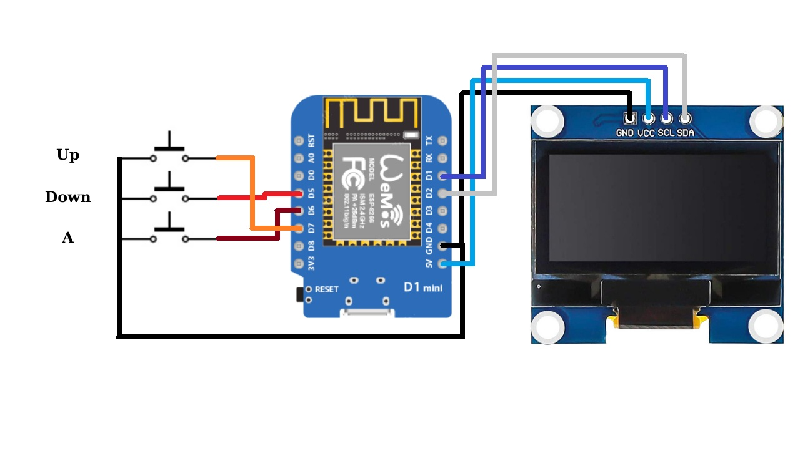

# diy_esp32_hacking_project(:<

NOTE: This is only for educational purposes only

Hi i am Jhon i will be teaching and showing you simple hacking devices and how to use
What you need for some projects

## Contents
1. [M5Stack Stick S3](m5%20stack%20stick%20s3.md)
2. [ESP32 Marauder](esp32-marauder.md)
3. [ESP8266 Deauther](#esp8266-deauther)
4. [Credits & Acknowledgements](#credits--acknowledgements)

esp8266 deauth you [can buy one](https://dstike.com/products/dstike-wifi-deauther-mini?srsltid=AYCX9vIDw-9Hq-6xPS5ixksbyq0SnOedBFWNUeOaF1hb-wkfWueySQ_I)or you can build one 

things to buy:
1.esp8266 mini d1 or d1 pro

2.oled 4 pin display screen 

3. wires

4. 3 buttons

4 pin display pins:

• OLED VCC → 3V3 

• OLED GND → GND

• OLED SDA → GPIO 4 (D2) 

• OLED SCL → GPIO 5 (D1)

Button pins:

•UP	D5	GPIO 14	GND	

•DOWN	D6	GPIO 12	GND	

•SELECT (BUTTON_A)	D7	

•BACK (BUTTON_B) (Optional)	D3	GPIO 0	GND

to flash download [esp8266 d1/esp8266 d1 pro](https://github.com/ianisking808-blip/diy_esp32_hacking_projects/blob/main/esp8266_deauther_2.6.1_WEMOS_D1_MINI.bin)

# Credits & Acknowledgements

A huge thank you to the developers and open-source projects that made these projects possible.

### ESP32 Marauder
- **Creator:** JustCallMeKoko
- GitHub: https://github.com/justcallmekoko
- Original project: https://github.com/justcallmekoko/ESP32Marauder

### ESP8266 Deauther
- **Creator:** Spacehuhn
- GitHub: https://github.com/Spacehuhn
- Original project: https://github.com/SpacehuhnTech/esp8266_deauther

### Acknowledgement
ESP32 Marauder was originally inspired by ESP8266 Deauther.

All original developers retain credit for their respective work. This project is independently maintained and is not an official release of either project.

Please refer to the original repositories for their respective licenses and usage conditions.

Bruce Firmware:
https://github.com/pr3y/Bruce

Original project and contributors:
https://github.com/bmorcelli
https://github.com/IncursioHack
https://github.com/Luidiblu
https://github.com/eadmaster
https://github.com/rennancockles
https://github.com/7h30th3r0n3
https://github.com/Tawank
https://github.com/geo-tp

All original authors retain credit
for their respective work.
