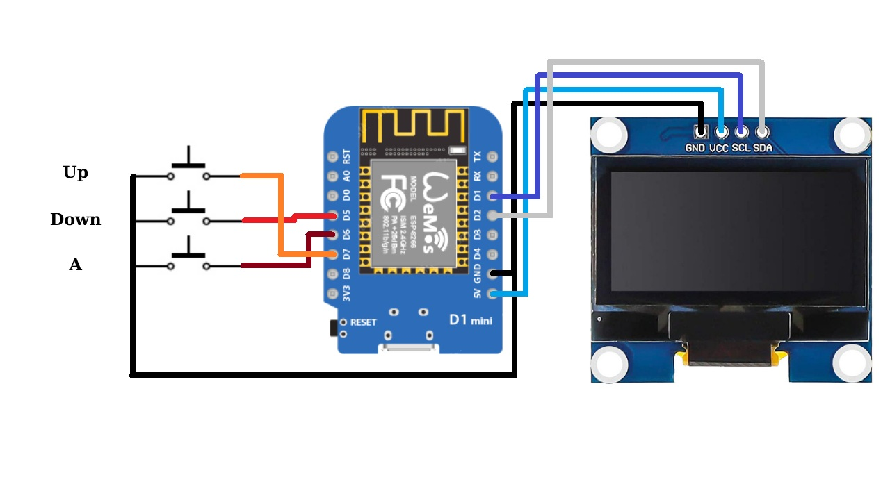

esp8266 deauth you [can buy one](https://dstike.com/products/dstike-wifi-deauther-mini?srsltid=AYCX9vIDw-9Hq-6xPS5ixksbyq0SnOedBFWNUeOaF1hb-wkfWueySQ_I)or you can build one 

things to buy:
1.esp8266 mini d1 or d1 pro

2.oled 4 pin display screen 

3. wires

4. 3 buttons

4 pin display pins:

• OLED VCC → 3V3 

• OLED GND → GND

• OLED SDA → GPIO 4 (D2) 

• OLED SCL → GPIO 5 (D1)

Button pins:

•UP	D5	GPIO 14	GND	

•DOWN	D6	GPIO 12	GND	

•SELECT (BUTTON_A)	D7	

•BACK (BUTTON_B) (Optional)	D3	GPIO 0	GND

to flash download [esp8266 d1/esp8266 d1 pro](https://github.com/ianisking808-blip/diy_esp32_hacking_projects/blob/main/esp8266_deauther_2.6.1_WEMOS_D1_MINI.bin)
